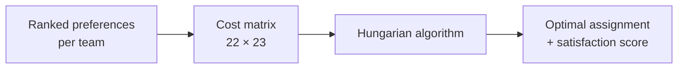

# Algorithme du Bonheur

Assigns final-year projects to student teams from their ranked preferences, so that the class as a whole gets the best possible outcome.

**Live:** https://ged-project-matcher.vercel.app

## The problem

In the GEDI program at ENSAM Meknès, 22 teams choose among 23 projects. Assigning them by hand or first come, first served leaves some teams with a project they never wanted. I built this tool to treat the assignment as what it is: an optimization problem.

## How it works

1. Each team signs in and ranks the projects by drag and drop.
2. A rank becomes a score: 23 points for a first choice, 22 for the second, down to 1.
3. The scores form a teams × projects cost matrix. A project a team did not rank gets a prohibitive cost.
4. The **Hungarian algorithm** (Kuhn-Munkres) finds the one-to-one assignment with the highest total score. The matrix is rectangular, so one project stays unassigned.
5. The administrator runs the matching and sees, for each team, the project obtained, the rank it had given and the overall satisfaction score.



The matching logic is in [`src/actions/match-projects.ts`](src/actions/match-projects.ts).

## Stack

| | |
|---|---|
| Framework | Next.js 16 (App Router, server actions), React 19, TypeScript |
| Database & auth | Supabase (PostgreSQL with row-level security); schema in [`supabase/schema.sql`](supabase/schema.sql) |
| Matching | `munkres-js` |
| UI | Tailwind CSS, shadcn/ui, dnd-kit |
| Hosting | Vercel |

## Run locally

```bash
npm install
# .env.local: NEXT_PUBLIC_SUPABASE_URL and NEXT_PUBLIC_SUPABASE_PUBLISHABLE_DEFAULT_KEY
# apply supabase/schema.sql to your Supabase project
npm run dev
```

## Author

Iliass KAOUACHI · [github.com/K-171](https://github.com/K-171) · [LinkedIn](https://www.linkedin.com/in/iliass-kaouachi)
